# املاک آرامش | دموی دو پکیج

دموی کامل و قابل اجرای دو وب‌سایت فارسی راست‌به‌چپ برای «املاک آرامش / تهران».

## دموی آنلاین

- صفحه‌ی انتخاب پکیج: <https://imamirho3ein.github.io/aramesh-estate/>
- پکیج ۱ (کلاسیک): <https://imamirho3ein.github.io/aramesh-estate/classic/>
- پکیج ۲ (هوشمند): <https://imamirho3ein.github.io/aramesh-estate/smart/>
- مخزن کد: <https://github.com/Imamirho3ein/aramesh-estate>

نسخه‌ی آنلاین به‌صورت استاتیک روی GitHub Pages منتشر می‌شود و با هر push به شاخه‌ی `main` به‌روزرسانی می‌گردد.

- **پکیج ۱ — کلاسیک حرفه‌ای:** طراحی رسمی و مطمئن با پالت کرم/زمردی/طلایی.
- **پکیج ۲ — هوشمند و پیشرفته:** همه‌ی امکانات پکیج ۱ به‌همراه تور ۳۶۰، دستیار هوشمند، مقایسه‌ی هوشمند، نقشه‌ی تعاملی، پنل مشتری و CRM.

صفحه‌ی انتخاب دمو: `/`

---

## تصاویر دمو

روی هر تصویر بزنید تا نسخه‌ی کامل و صفحه‌ی زنده‌ی همان بخش باز شود.

### صفحه‌ی انتخاب پکیج

[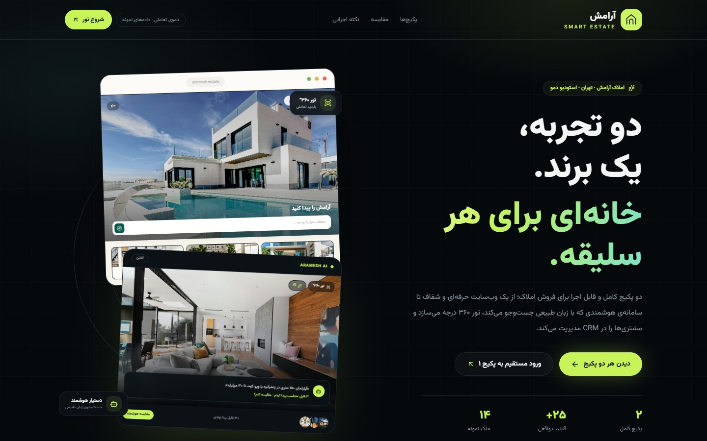](https://imamirho3ein.github.io/aramesh-estate/)

### پکیج ۱ — کلاسیک

| صفحه‌ی اصلی | لیست املاک |
| :---: | :---: |
| [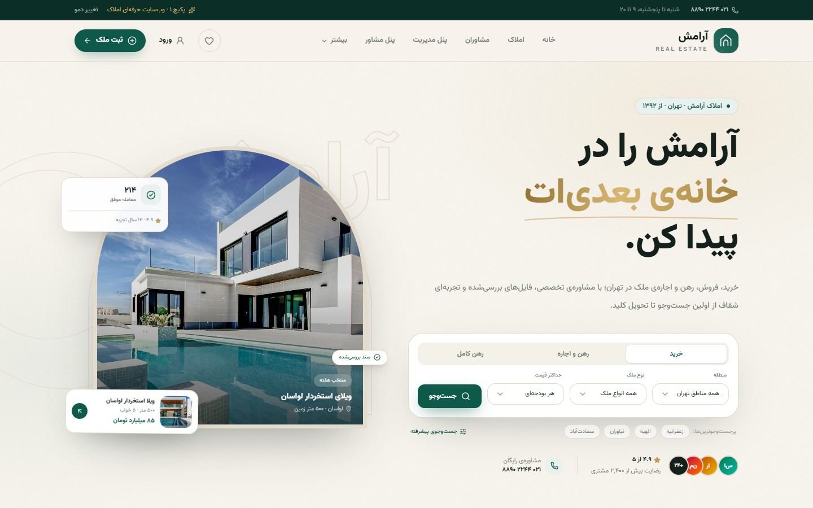](https://imamirho3ein.github.io/aramesh-estate/classic/)<br>**صفحه‌ی اصلی** | [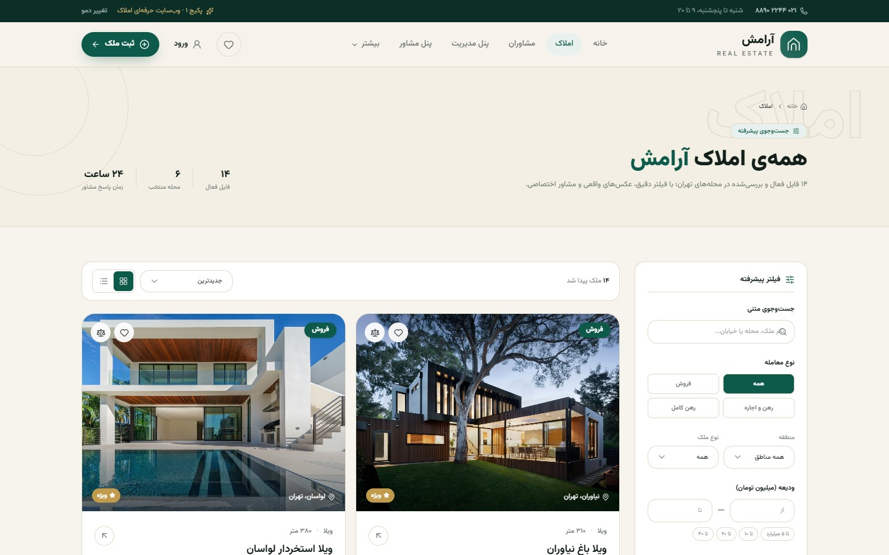](https://imamirho3ein.github.io/aramesh-estate/classic/properties/)<br>**لیست املاک با فیلتر** |
| [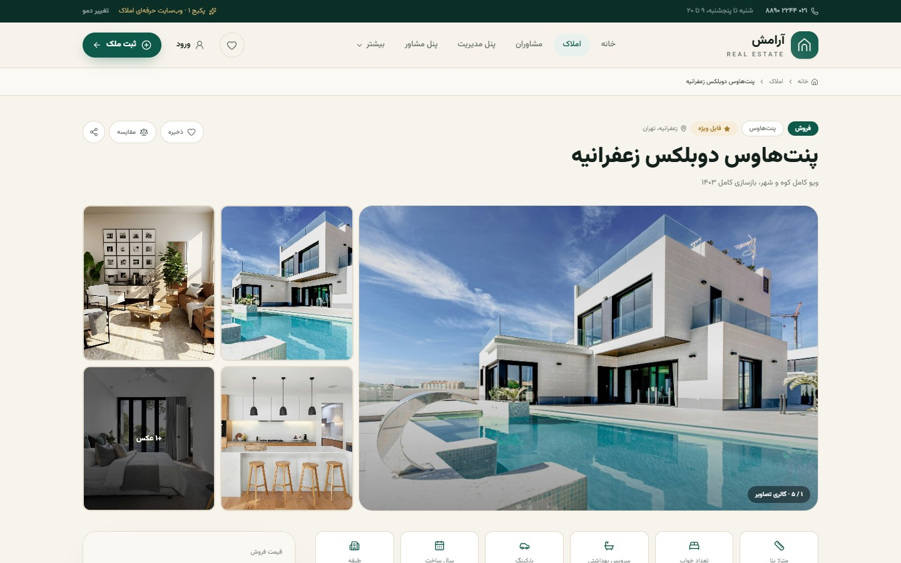](https://imamirho3ein.github.io/aramesh-estate/classic/properties/p1/)<br>**جزئیات ملک و گالری** | [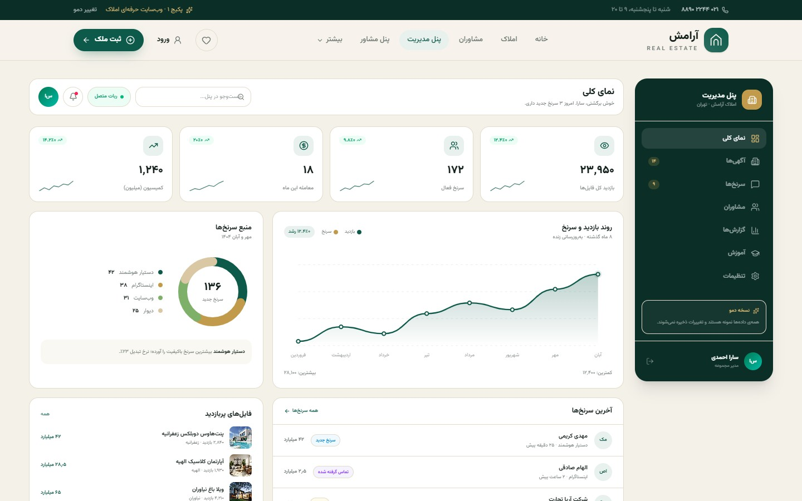](https://imamirho3ein.github.io/aramesh-estate/classic/dashboard/)<br>**داشبورد مدیریت** |

### پکیج ۲ — هوشمند

| صفحه‌ی اصلی | جست‌وجوی هوشمند |
| :---: | :---: |
| [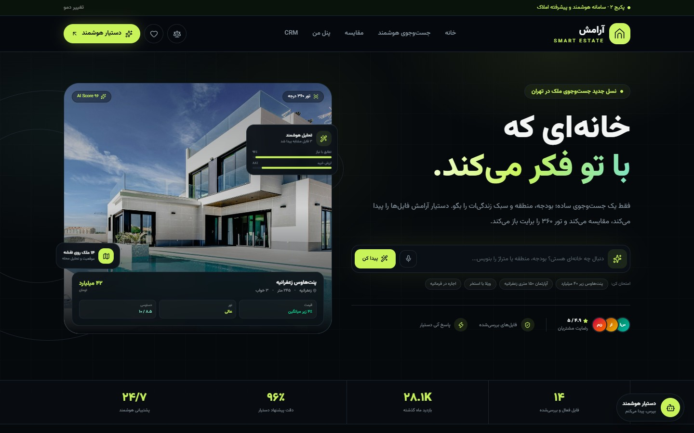](https://imamirho3ein.github.io/aramesh-estate/smart/)<br>**صفحه‌ی اصلی** | [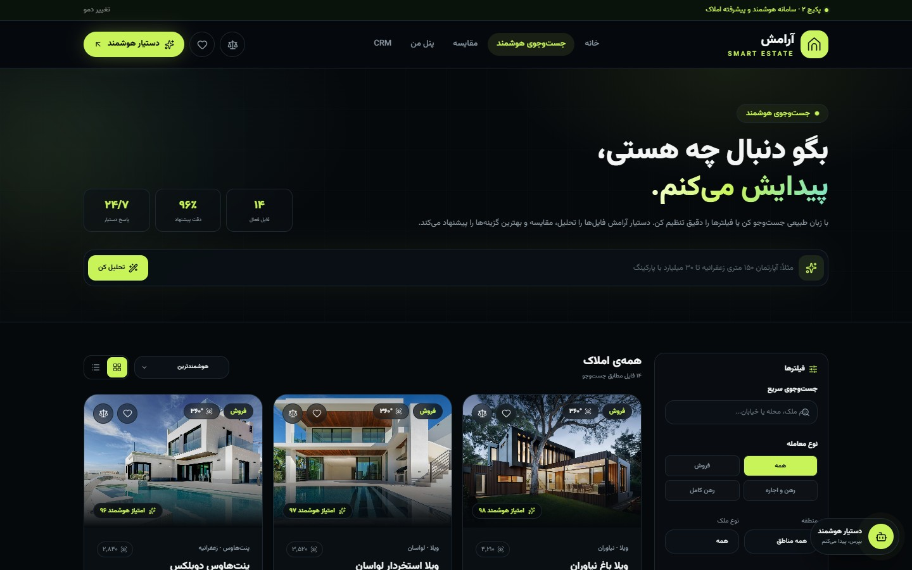](https://imamirho3ein.github.io/aramesh-estate/smart/explore/)<br>**جست‌وجو، فیلتر و نقشه** |
| [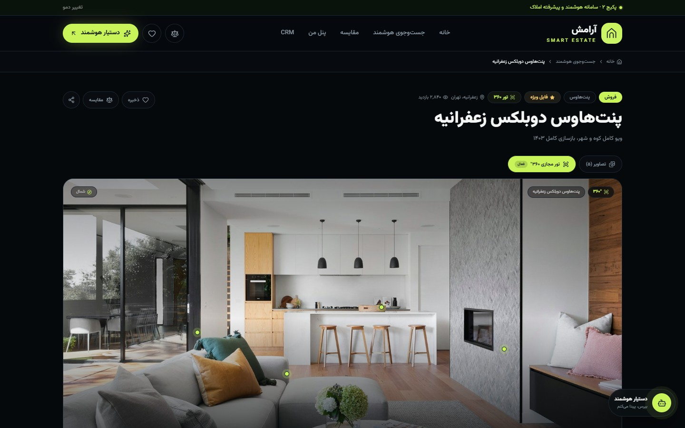](https://imamirho3ein.github.io/aramesh-estate/smart/properties/p1/)<br>**جزئیات ملک + تور ۳۶۰** | [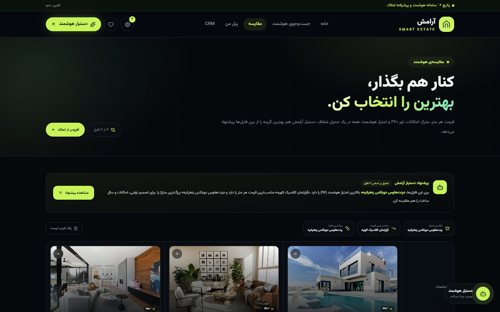](https://imamirho3ein.github.io/aramesh-estate/smart/compare/)<br>**مقایسه‌ی هوشمند** |
| [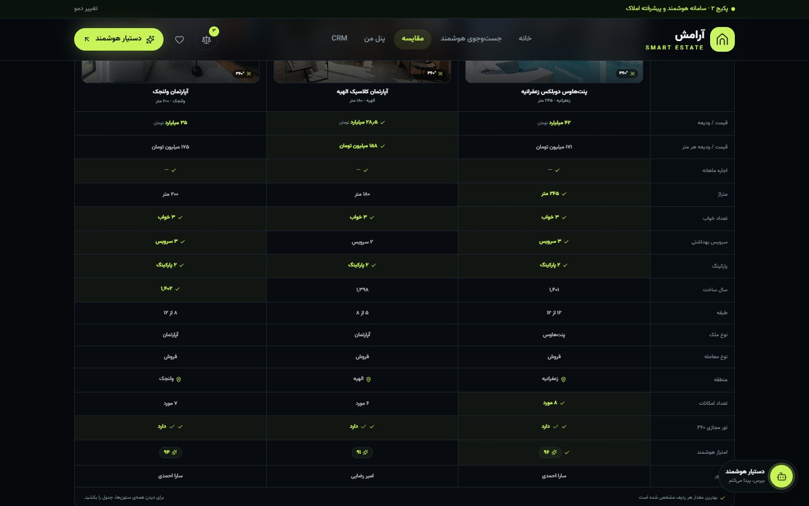](https://imamirho3ein.github.io/aramesh-estate/smart/compare/)<br>**جدول مقایسه و امتیاز هوشمند** | [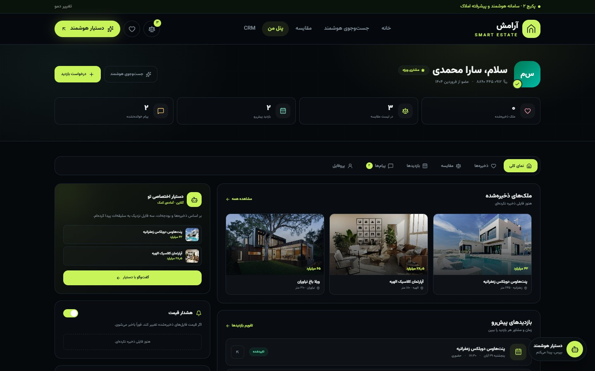](https://imamirho3ein.github.io/aramesh-estate/smart/account/)<br>**پنل مشتری** |
| [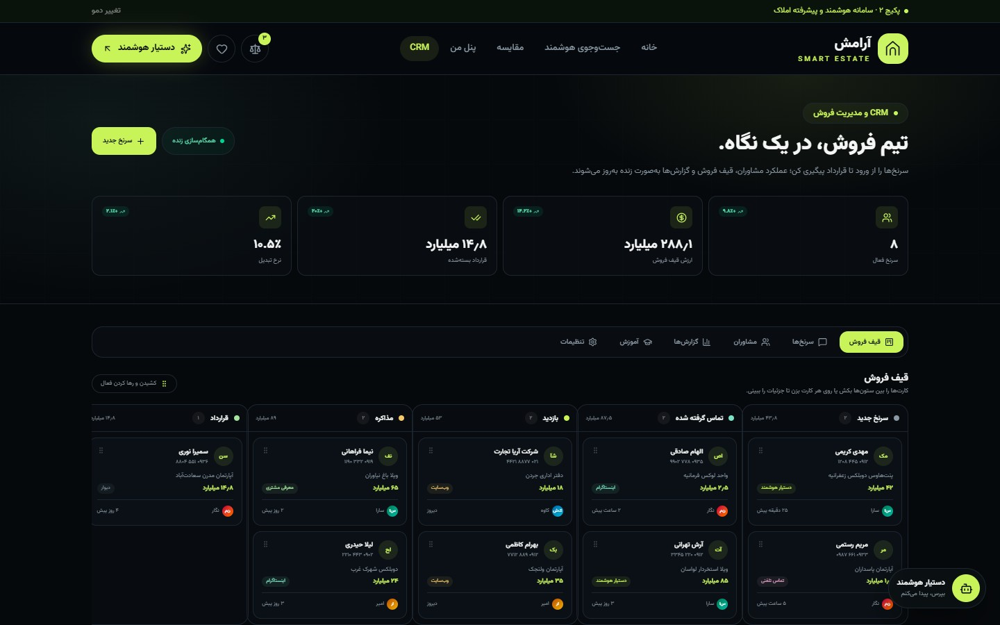](https://imamirho3ein.github.io/aramesh-estate/smart/crm/)<br>**CRM و آمار فروش** | [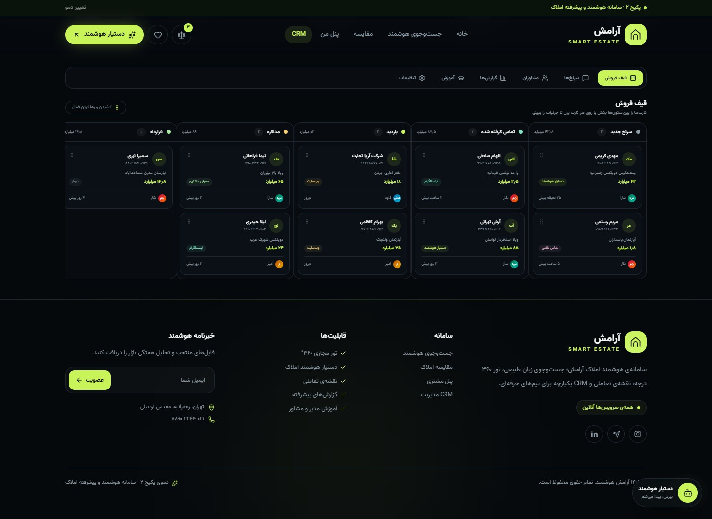](https://imamirho3ein.github.io/aramesh-estate/smart/crm/)<br>**قیف فروش و کارت سرنخ‌ها** |

### نمای موبایل

| هاب | کلاسیک | هوشمند |
| :---: | :---: | :---: |
| [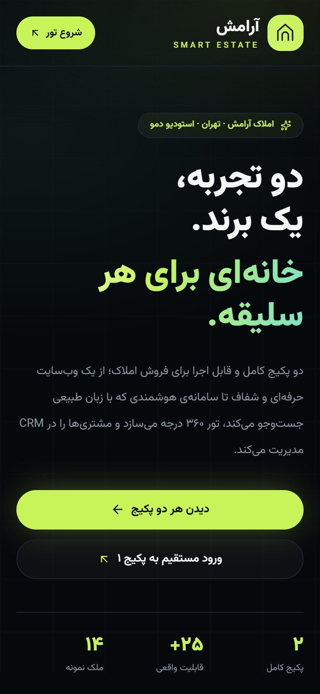](https://imamirho3ein.github.io/aramesh-estate/) | [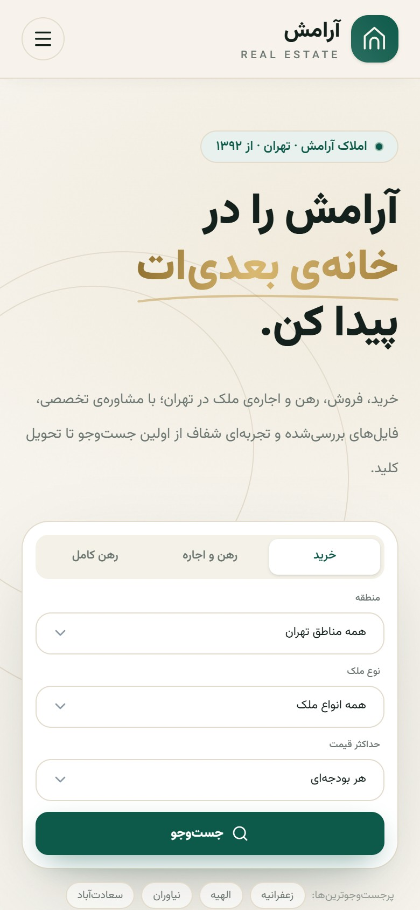](https://imamirho3ein.github.io/aramesh-estate/classic/) | [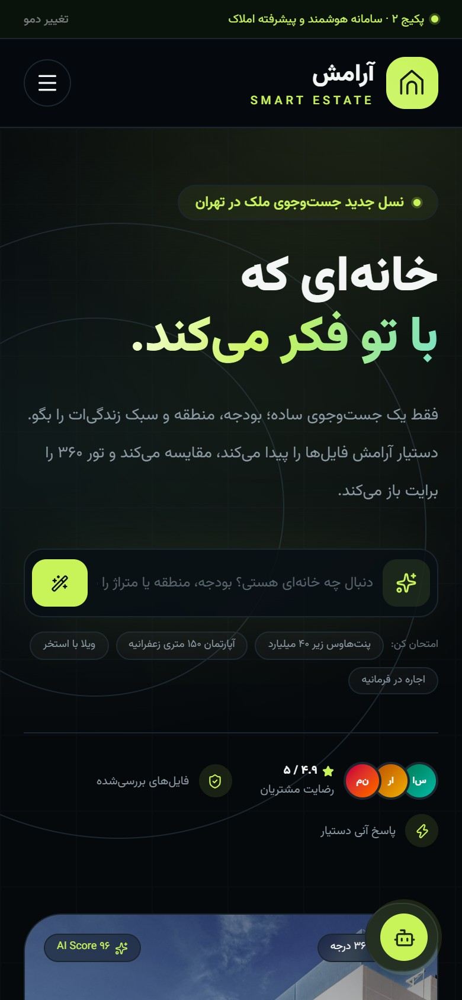](https://imamirho3ein.github.io/aramesh-estate/smart/) |

---

## اجرا

```bash
npm install
npm run dev
```

سپس `http://localhost:3000` را باز کنید.

نسخه‌ی production:

```bash
npm run build
npm start
```

---

## نقشه‌ی صفحات

### انتخاب دمو
| مسیر | توضیح |
| --- | --- |
| `/` | هاب انتخاب پکیج ۱ یا پکیج ۲ |

### پکیج ۱ — کلاسیک
| مسیر | توضیح |
| --- | --- |
| `/classic` | صفحه‌ی اصلی، جست‌وجو، فایل‌های منتخب، مشاوران، نظرات |
| `/classic/properties` | لیست فایل‌ها با فیلتر و مرتب‌سازی |
| `/classic/properties/[id]` | جزئیات ملک، گالری، مشاور، فرم تماس |
| `/classic/consultants` | معرفی مشاوران و مناطق فعالیت |
| `/classic/login` | ورود دمو با انتخاب نقش |
| `/classic/dashboard` | داشبورد مدیر: آمار، فایل‌ها، سرنخ‌ها |
| `/classic/panel` | پنل مشاور: فایل‌ها، بازدیدها، پیگیری |

### پکیج ۲ — هوشمند
| مسیر | توضیح |
| --- | --- |
| `/smart` | صفحه‌ی اصلی هوشمند با جست‌وجوی زبان طبیعی |
| `/smart/explore` | جست‌وجو، فیلتر، نقشه‌ی تعاملی تهران، دستیار |
| `/smart/properties/[id]` | جزئیات + گالری + تور ۳۶۰ + بینش هوشمند + فرم تماس |
| `/smart/compare` | مقایسه‌ی تا ۳ ملک با جدول و امتیاز هوشمند |
| `/smart/account` | پنل مشتری: ذخیره‌ها، مقایسه، بازدیدها، پیام‌ها، پروفایل |
| `/smart/crm` | CRM: قیف فروش، سرنخ‌ها، مشاوران، گزارش‌ها، آموزش، تنظیمات |

---

## ورود دمو

در `/classic/login` هر شماره و رمزی پذیرفته می‌شود. نقش را انتخاب کنید:

- **مدیر** → `/classic/dashboard`
- **مشاور** → `/classic/panel`
- **مشتری** → `/smart/account`

رمز پیش‌فرض نمایشی: `aramesh-demo`

---

## امکانات کلیدی

- ۱۴ فایل نمونه با تصاویر محلی، قیمت، متراژ، امکانات و مشاور.
- جست‌وجوی فارسی زبان طبیعی در پکیج ۲ (مثلاً «ویلا با استخر در لواسان» یا «اجاره زیر ۲۰ میلیون در زعفرانیه»).
- تور ۳۶۰ درگ‌کردنی با هات‌اسپات.
- مقایسه‌ی هوشمند با ذخیره‌سازی در مرورگر و سقف ۳ ملک.
- علاقه‌مندی‌ها، توست‌ها و وضعیت ماندگار با `localStorage`.
- نقشه‌ی شماتیک تهران با فیلتر منطقه و انتخاب ملک.
- CRM با کشیدن‌ورهاکردن کارت‌ها، افزودن سرنخ، تغییر مرحله، گزارش‌های نموداری و آموزش مدیر/مشاور.
- پنل مشتری با درخواست بازدید، پیام‌ها، پروفایل و پیشنهادهای هوشمند.
- کاملاً RTL با فونت وزیرمتن محلی؛ بدون وابستگی به سرویس خارجی در زمان اجرا.

---

## نکات تحویل و اجرا

این پروژه یک **دموی کامل** است؛ داده‌ها نمونه و ذخیره‌سازی سمت مرورگر است. برای نسخه‌ی عملیاتی:

- **تور ۳۶۰:** نیاز به تولید محتوا (عکاسی ۳۶۰، پانوراما، هات‌اسپات) دارد و در قیمت نهایی جداگانه لحاظ می‌شود.
- **دستیار هوشمند:** نسخه‌ی دمو قاعده‌محور است. اتصال به مدل زبانی/API نیازمند کلید، بودجه‌ی سرویس و تنظیمات امنیتی است.
- **پیامک، ایمیل، درگاه پرداخت، واتس‌اپ و ربات تلگرام:** در دمو شبیه‌سازی شده‌اند؛ فعال‌سازی واقعی نیازمند حساب سرویس و کلید API است.
- **CRM و پنل‌ها:** داده‌ها در حافظه‌ی مرورگر نگه داشته می‌شوند؛ نسخه‌ی واقعی نیازمند پایگاه‌داده و احراز هویت است.
- تصاویر و متن‌ها نمونه‌اند و پیش از انتشار با محتوای واقعی دفتر جایگزین می‌شوند.
